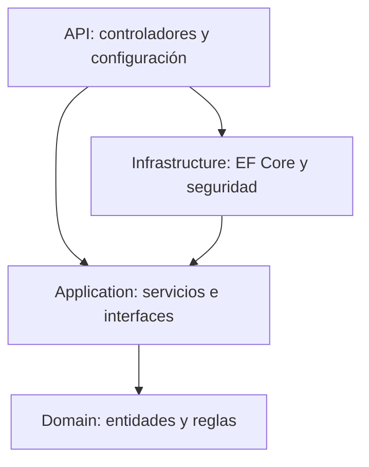

# Investigación: Clean Architecture

Clean Architecture organiza un sistema según las responsabilidades de cada parte. Su idea central es que las reglas del negocio sean independientes de la base de datos y de la interfaz.

## Regla de dependencias

Las dependencias del código apuntan hacia las capas internas. Por eso Application define interfaces y Infrastructure las implementa. Cambiar PostgreSQL por otro almacenamiento permite conservar las operaciones del negocio, aunque exige cambiar y probar la implementación de datos.

La referencia de API a Infrastructure se usa al iniciar la aplicación para registrar dependencias. Los controladores reciben interfaces de Application.

## Aplicación en el laboratorio

Se eligió el Lab05 de gestión académica. Al procesar una matrícula, la API recibe la solicitud, Application comprueba estudiante, curso y profesor, Domain valida la matrícula e Infrastructure guarda los datos mediante UnitOfWork.

## Beneficios

- Permite ubicar cada responsabilidad.
- Reduce el impacto de cambiar detalles externos.
- Facilita probar operaciones con implementaciones de prueba.

Separar proyectos agrega archivos y configuración. Conviene mantener la implementación simple y entender las referencias, porque crear carpetas por sí solo no aplica esta arquitectura.

## Fuentes consultadas

- [Microsoft Learn: Arquitecturas de aplicaciones web comunes, sección Arquitectura limpia](https://learn.microsoft.com/es-es/dotnet/architecture/modern-web-apps-azure/common-web-application-architectures).
- [Microsoft Learn: Principios arquitectónicos](https://learn.microsoft.com/en-us/dotnet/architecture/modern-web-apps-azure/architectural-principles).
- [Microsoft Learn: Configuración y ciclo de vida de DbContext](https://learn.microsoft.com/en-us/ef/core/dbcontext-configuration/).

Consulta: 12 de octubre de 2026.
